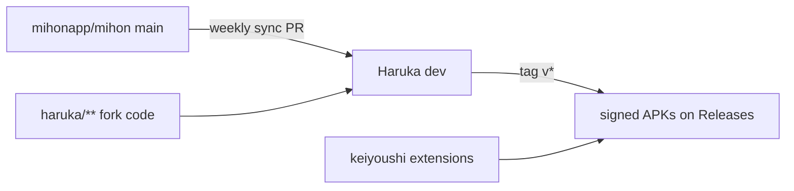

<div align="center">


# Haruka (遥か, "far away")

**My personal build of [Mihon](https://github.com/mihonapp/mihon), tuned for a very long reading list.**

*Hundreds of series, hundreds of thousands of chapters, and one clean chapter list per series. Android 8.0+.*

[](https://github.com/hoshinoht/haruka/releases)
[](https://github.com/mihonapp/mihon)
[](https://github.com/keiyoushi/extensions-source)
[](../LICENSE)

[Why](#why-haruka) · [Features](#features) · [Install](#install) · [Staying close to Mihon](#staying-close-to-mihon) · [Development](#development) · [Credits](#credits)

</div>

> **Everything Mihon does, plus the handful of things I kept wishing it did.**
> Haruka is not a replacement for Mihon and is not affiliated with it. If you want the app most people use, [get Mihon](https://mihon.app).

> [!NOTE]
> Beta. Haruka follows Mihon's development branch and is built and used by one person. Backups stay restorable by stock Mihon, and keiyoushi extensions work unchanged. Please report Haruka problems [here](https://github.com/hoshinoht/haruka/issues), not to the Mihon project.

## Why Haruka

My library outgrew the way chapter lists work. A popular series often has the same chapter from the official release, two scanlation groups and an aggregator, so the list repeats every chapter three or four times. Haruka keeps one copy of each chapter, preferring the official one, and keeps the rest a tap away. The other features came from the same habit: reading a lot, across many sources, and wanting the app to keep up.

The name is 遥か, "far away": the long haul of a reading list that never ends. The look is borrowed from Takanashi Hoshino of Blue Archive, pink on Abydos navy.

## At a glance

| | |
|---|---|
| **Base** | [mihonapp/mihon](https://github.com/mihonapp/mihon) `main`, merged weekly |
| **Package** | `app.haruka`, installs beside Mihon |
| **Extensions** | [keiyoushi/extensions-source](https://github.com/keiyoushi/extensions-source), unmodified extension API |
| **Backups** | Mihon's format; restore a Mihon (or Komikku) backup to move in |
| **Updates** | In-app updater from this repository, with an optional beta channel |
| **Sync** | Optional, through a hidden app folder in your own Google Drive; no Haruka server |

## Features

### Chapters
- **Official-first deduplication:** one copy per chapter in the list, reader, downloads and read marking, with your own rules, scanlator ranking and per-series overrides.
- **Versions on demand:** other copies and split parts sit under a small chip on the chapter row.
- **Duplicates marked together:** finishing a chapter marks its other copies read.

### Library and updates
- **Grouped Updates:** chapters grouped per series and day, optionally as conversations.
- **Panorama covers:** wide covers shown in full instead of cropped.
- **Progress banners:** library updates and backup restores show progress inside the app.
- **Update errors:** a screen listing the series that failed the last library update.
- **Related titles and short titles:** suggestions from the extension on each series, and titles without trailing lists of alternative names.

### Sync
- **Google Drive sync:** library, categories, reading progress, history, tracker links and Haruka settings stay the same on every device, stored only in a hidden folder in your own Drive.
- **Combines, never overwrites:** a chapter read anywhere stays read, the furthest page wins, and large removals wait for your confirmation.
- **Automatic:** after reading, on app open and close, and on a schedule; optional end-to-end encryption. Details in [sync.md](../docs/haruka/sync.md).

### Migration
- **Range selection:** long-press to select a range, select all or none, jump to either end.
- **Unavailable sources:** flagged in Migrate and movable all at once.
- **Long-press to add or remove** a series from global search results.

### Look and feel
- **Hoshino theme:** the default, in dark and light.
- **Animations:** *Standard* is Mihon's motion; *Expressive* adds Material 3 Expressive springs, morphing loaders and pill swipe actions; *Reduced* keeps motion to short fades and follows the system setting.
- **Floating selection toolbar** on multi-select screens.

The full list per release is in the [Haruka changelog](../docs/haruka/CHANGELOG.md). Everything else is Mihon: see [Mihon's site](https://mihon.app) and its [changelog](../CHANGELOG.md).

## Install

**Requirements:** Android 8.0 or newer.

1. Download `haruka-arm64-v8a-<version>.apk` from [Releases](https://github.com/hoshinoht/haruka/releases) (most phones), or the universal `haruka-<version>.apk`.
2. Install it. Haruka installs next to Mihon; it does not replace it.
3. To bring your library over, create a backup in Mihon and restore it in Haruka (More › Data and storage › Restore backup).

## Staying close to Mihon

Haruka is a thin layer on top of Mihon, kept thin on purpose so that every Mihon improvement arrives with little effort.



- **Fork code lives apart:** Haruka's features live in their own packages; Mihon's files only get small marked hooks.
- **No database changes:** Mihon's schema is untouched, so upgrades and backups keep working both ways.
- **Extensions untouched:** the extension API and loader match Mihon exactly.
- **Converge when Mihon catches up:** if Mihon ships an equivalent feature, Haruka drops its own version.

The rules are in [AGENTS.md](../AGENTS.md).

## Development

```bash
./gradlew spotlessApply spotlessCheck
./gradlew testDebugUnitTest
./gradlew assembleDebug
scripts/haruka/patch-surface.sh   # how much of Mihon Haruka touches
```

Releases are built by GitHub Actions from a `v*` tag; `scripts/haruka/build-release.sh` builds the same signed APKs locally.

## Credits

Haruka exists because of [Mihon](https://github.com/mihonapp/mihon) and everyone who built it and Tachiyomi before it. Thank you.

<a href="https://github.com/mihonapp/mihon/graphs/contributors">
  
</a>

Some features are adapted from [Komikku](https://github.com/komikku-app/komikku) and [TachiyomiSY](https://github.com/jobobby04/TachiyomiSY). The rounded headings use Zen Maru Gothic under the SIL Open Font License (see [NOTICE](../NOTICE)).

### Disclaimer

Haruka hosts no content and has no affiliation with the content providers its extensions reach.

### License

Apache License 2.0, like Mihon. See [LICENSE](../LICENSE) and [NOTICE](../NOTICE).

<pre>
Copyright © 2015 Javier Tomás
Copyright © 2024 Mihon Open Source Project
</pre>
